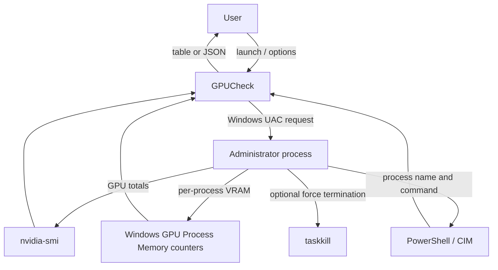

# GPUCheck

GPUCheck lists processes using GPU memory and can terminate selected processes. On Windows with WDDM, it reads the
`GPU Process Memory` performance counters for per-process dedicated and shared memory, and uses `nvidia-smi` for GPU
totals. On other platforms, it falls back to `nvidia-smi` compute-app data.

## Requirements

- Windows 10/11 for GPU process counters and the packaged executable.
- NVIDIA drivers with `nvidia-smi` available on `PATH`.
- Python 3 to run from source or build the executable.
- PyInstaller, installed by the build script from `requirements.txt`.

## Run from source

```powershell
python .\gpucheck.py
python .\gpucheck.py --no-interactive
python .\gpucheck.py --json
python .\gpucheck.py --kill 1234 5678
```

On Windows the script requests administrator access at launch. Approving the prompt runs the entire process elevated,
including `--kill`; cancelling it stops the program. Interactive process termination requires a `y` confirmation and
uses `taskkill /F /T`. Use `--kill` carefully: it forcefully terminates the specified processes and their child
processes.

Interactive mode accepts row selections such as `1,3` or `2-4`, `r` to refresh, and `q` to quit.

## Build the Windows executable

From PowerShell in the project directory:

```powershell
.\build_exe.ps1
```

The script installs dependencies from `requirements.txt`, then creates a one-file console executable at
`dist\GPUCheck.exe`. To run it:

```powershell
.\dist\GPUCheck.exe
.\dist\GPUCheck.exe --json
.\dist\GPUCheck.exe --kill 1234
```

The executable still needs the NVIDIA driver utilities (`nvidia-smi`) and Windows PowerShell available on the target
machine. PyInstaller bundles Python and the application, not these system tools.

## Component diagram


